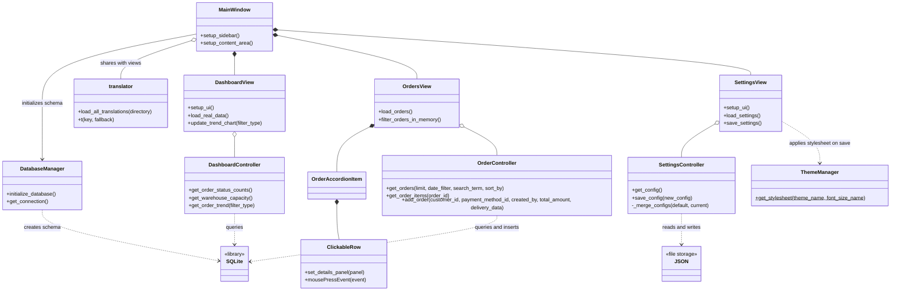

# ERP & Warehouse Management System

## Project Overview

This engineering thesis project is a Python desktop application for store and
warehouse operations. The source includes dashboard analytics, an order browser,
and application settings, together with a SQLite schema for inventory, customers,
products, picking, shipments, and invoices. Several workflows remain incomplete,
and the current startup and order-loading limitations are listed below.

English and Polish translation dictionaries are included. Some existing UI and
data labels still use fixed-language values. [updates.md](updates.md) records
change history; this README describes the current application.

## Current Functionality

- **Dashboard:** Database queries provide order-status counts and order inflow
  comparisons. The capacity chart uses a provisional unit-count calculation.
- **Order browser:** The view defines expandable item details, order ID/status
  and customer-name search, date filters, and result limits. Populated results
  are currently blocked by the row-contract defect described below.
- **Settings:** Four pages persist paths, company details, appearance/localization,
  and system preferences through `SettingsController`.
- **Appearance:** `ThemeManager` supplies Dark, Light, and Modern palettes and
  Small, Medium, and Large fonts. Saving appearance settings reapplies the
  application stylesheet; some local widget styling still overrides it.
- **Persistence:** Database initialization creates the schema and initial
  dictionary values. Separate delivery and billing fields are present.

### Current Limitations

- Git tracks `Models/database.py`, while application imports use
  `models.database`. A clean checkout can fail to import the database module.
- `OrderController.get_orders()` returns 14 named fields, but `OrdersView`
  unpacks nine positional values. Loading existing orders fails; an empty order
  table masks the problem.
- The dashboard uses the configured database path, while `OrdersView` creates
  its controller with default `warehouse.db`. A nondefault path can therefore
  show different data or fail when the default database lacks the schema.
- Products is a placeholder. Customer management and pick-list creation or
  execution screens are absent. Add/Import and order-detail action buttons do
  not provide complete workflows. The controller's order-insertion method is
  not connected to an order-creation form.
- Invoice, shipment, package, and inventory tables do not establish working
  invoicing, shipping, stock-movement, or reporting features.
- Warehouse utilization divides inventory unit count by a fixed capacity of
  10,000 and estimates “In picking” as 5% of rack usage. It does not measure
  mass or volume and does not enforce rack limits.
- Local widget and chart colors do not fully follow theme changes. Language
  changes require a restart, and localization remains partial.
- Notification, backup, and path-browse controls do not establish that those
  operational features are implemented.

## Technology Stack

| Area | Implementation |
| --- | --- |
| Language | Python 3 |
| Desktop interface | PySide6 (Qt for Python, including Qt Charts) |
| Persistence | Python's `sqlite3` library and local SQLite files |
| Configuration | JSON |
| Regression tests | Standard-library `unittest`, temporary configuration, offscreen Qt |

## Company Settings

In **Settings > Company Data**, the company address is edited in separate
**Street**, **Postal Code**, and **City** fields. These map directly to the existing
`company_info.street`, `company_info.postal_code`, and `company_info.city` JSON
keys. Saving and reopening settings preserves each component independently.
The labels are available in English and Polish, within the existing four-page
Settings layout.

If an older configuration contains duplicated address text, correct the affected
field explicitly and save. Existing text is displayed as stored; the application
does not guess which parts to remove. No configuration migration is required.

### Settings Regression Tests

With Python 3 and PySide6 installed, run from the repository root:

```text
python -B -m unittest discover -s tests -v
```

The tests use temporary JSON configuration files and Qt's offscreen platform by
default. They do not open the application's database or modify its configuration.
They cover repeated save/reopen cycles, individual component edits, explicit
correction of existing text, and address fields in both languages and all three
themes and font sizes. Change history is recorded in [updates.md](updates.md).

## Project Structure

```text
controllers/       Orders, Dashboard, and Settings logic
Models/database.py Tracked SQLite schema and dictionary initialization
utils/             Translation loader, JSON dictionaries, and ThemeManager
views/             Dashboard, Orders, and Settings widgets
main.py            Application entry point, main window, and navigation
tests/             Isolated company-settings regression tests
config.json        Application configuration and preferences
README.md          Current application state and architecture
updates.md         Application change history
```

Database files and the local `seed_db.py` script are ignored by Git. A fresh clone
does not include populated demonstration data or that seed script.

## Running the Application

Use a Python environment with PySide6 installed and launch from the repository
root, where relative configuration, database, and translation paths are resolved:

```text
python main.py
```

There is no dependency manifest at present. Startup reads `config.json`,
initializes the configured SQLite schema, loads dictionaries from `utils/`, and
creates the screens. The import, populated-order, and database-path defects
listed above currently prevent a reliable clean-checkout launch. Use the
isolated test command above to validate company settings without opening or
modifying the working database.

## System Architecture

The application separates PySide6 views from controllers. Module-level code in
`main.py` loads configuration and translations, applies the theme, and constructs
`MainWindow`; there is no `MainApp` class. The window connects navigation buttons
to a `QStackedWidget`: Dashboard, Orders, a Products placeholder, and Settings.
The simplified diagram lists selected implemented methods and dependencies.



Orders widgets delegate SQL to `OrderController`. The Orders and Dashboard
controllers each open their own SQLite connections; they do not query through
`DatabaseManager`. `SettingsController` manages JSON configuration. Widget
composition describes ownership; it does not imply that every workflow is
complete or that the current order-row contract is valid.

## Database Architecture

The ERD covers all 17 application tables declared in `Models/database.py`.
`PK`, `FK`, and `UK` identify primary, foreign, and unique keys. Dictionary tables
provide Polish and English labels; shipping methods use `service_name_pl` and
`service_name_en` alongside a separate carrier name.

```mermaid
erDiagram
    %% CORE TABLES %%
    USERS {
        int user_id PK
        string username UK
        string password_hash
        string first_name
        string last_name
        string role
    }
    CUSTOMERS {
        int customer_id PK
        string first_name
        string last_name
        string email UK
        string street
        string postal_code
        string city
        datetime created_at
    }
    PRODUCTS {
        int product_id PK
        string sku UK
        string name_pl
        string name_en
        string desc_pl
        string desc_en
        float price
        float weight
        float length
        float width
        float height
    }

    %% WAREHOUSE MODULE %%
    LOCATIONS {
        int location_id PK
        string location_code UK "e.g., A1-01"
        float max_weight
        float max_volume
    }
    INVENTORY {
        int product_id PK, FK
        int location_id PK, FK
        int quantity
    }
    INVENTORY_TRANSACTIONS {
        int transaction_id PK
        int product_id FK
        int location_id FK
        int user_id FK
        int quantity_change "e.g., -2 or +10"
        string transaction_type "e.g., PICK, RESTOCK"
        datetime created_at
    }
    PICK_LISTS {
        int pick_list_id PK
        string status "e.g., PENDING"
        int assigned_user_id FK
        datetime created_at
    }
    PICK_LIST_ORDERS {
        int pick_list_id PK, FK
        int order_id PK, FK
    }

    %% ORDER & INVOICE MODULE %%
    ORDERS {
        int order_id PK
        int customer_id FK
        string status_code FK
        int payment_method_id FK
        int created_by FK
        datetime order_date
        float total_amount
        string delivery_name
        string delivery_second_name
        string delivery_street
        string delivery_postal_code
        string delivery_city
    }
    ORDER_ITEMS {
        int item_id PK
        int order_id FK
        int product_id FK
        int quantity
        float unit_price
    }
    ORDER_SHIPMENTS {
        int shipment_id PK
        int order_id FK
        int shipping_type_id FK
        string package_code FK
        string tracking_number
        float final_shipping_cost
    }
    INVOICES {
        int invoice_id PK
        int order_id FK
        string invoice_number UK
        string company_name
        string tax_id
        string billing_name
        string billing_second_name
        string billing_street
        string billing_postal_code
        string billing_city
        datetime issue_date
    }
    PACKAGES {
        int package_id PK
        int order_id FK
        string package_code FK
        string tracking_number UK
        float actual_weight
        datetime created_at
    }

    %% DICTIONARY TABLES (BILINGUAL SUPPORT) %%
    DICT_ORDER_STATUSES {
        string status_code PK
        string name_pl "e.g., Nowe"
        string name_en "e.g., New"
    }
    DICT_SHIPPING_METHODS {
        int shipping_id PK
        string carrier_name "e.g., InPost"
        string service_name_pl "e.g., Paczkomat"
        string service_name_en "e.g., Parcel Locker"
    }
    DICT_PAYMENT_METHODS {
        int id PK
        string name_pl "e.g., Przelew"
        string name_en "e.g., Bank Transfer"
    }
    DICT_PACKAGE_TYPES {
        string package_code PK
        string name_pl
        string name_en
        float max_weight
        float max_length
        float max_width
        float max_height
        float base_cost
    }

    %% --- RELATIONSHIPS --- %%

    %% 1. Core Order Flow
    CUSTOMERS |o--o{ ORDERS : "places"
    ORDERS |o--o{ ORDER_ITEMS : "contains"
    PRODUCTS |o--o{ ORDER_ITEMS : "is part of"
    
    %% 2. Order Fulfillment & Finance
    ORDERS |o--o{ INVOICES : "generates"
    ORDERS ||--o{ ORDER_SHIPMENTS : "shipped via"
    ORDERS ||--o{ PACKAGES : "has"
    ORDERS ||--o{ PICK_LIST_ORDERS : "assigned to"
    PICK_LISTS ||--o{ PICK_LIST_ORDERS : "contains"
    
    %% 3. Inventory & Warehouse
    PRODUCTS ||--o{ INVENTORY : "has stock in"
    LOCATIONS ||--o{ INVENTORY : "stores"
    PRODUCTS ||--o{ INVENTORY_TRANSACTIONS : "involved in"
    LOCATIONS ||--o{ INVENTORY_TRANSACTIONS : "location of"
    
    %% 4. User Actions
    USERS |o--o{ INVENTORY_TRANSACTIONS : "performs"
    USERS |o--o{ PICK_LISTS : "assigned to"
    USERS |o--o{ ORDERS : "created by"

    %% 5. Dictionaries
    DICT_ORDER_STATUSES |o--o{ ORDERS : "defines status"
    DICT_PAYMENT_METHODS |o--o{ ORDERS : "defines payment"
    DICT_SHIPPING_METHODS ||--o{ ORDER_SHIPMENTS : "defines carrier"
    DICT_PACKAGE_TYPES ||--o{ ORDER_SHIPMENTS : "defines package size"
    DICT_PACKAGE_TYPES ||--o{ PACKAGES : "defines package size"

```



### Schema Notes

- `INVENTORY` stores quantity for each product/location pair. `PICK_LIST_ORDERS`
  links orders and lists through a composite primary key.
- Invoices keep billing details independent of the customer and delivery address.
  `PACKAGES` and `ORDER_SHIPMENTS` are separate tables. The schema permits
  multiple invoices, shipments, or packages for one order.
- Relationship lines reflect declared foreign keys and nullable references;
  they do not represent completed workflows. The current connection methods do
  not explicitly enable SQLite foreign-key enforcement.
- Product weights, dimensions, and location limits are numeric fields without
  unit metadata. Real mass/volume capacity checks, reservations, active flags,
  customer phone numbers, and a virtual missing-stock location are not implemented.
