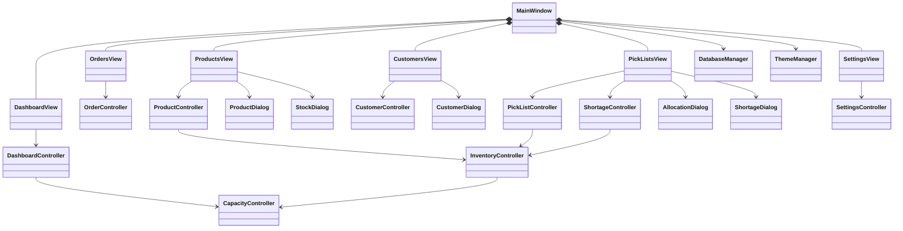

# ERP & Warehouse Management System

## Project Overview

This engineering thesis project is a Python/PySide6 desktop application for store
and warehouse operations. It provides an order browser, customer and product
maintenance, physical stock capacity checks, persistent picking workflows,
shortage reconciliation, dashboard analytics, and application settings. SQLite
stores business data; JSON stores configuration. English and Polish interfaces
share Dark, Light, and Modern themes.

[updates.md](updates.md) records change history. This README describes the current
application and its operational limits.

## Current Functionality and Limits

- Browse existing orders and their items, delivery details, dates, and totals.
- Add/edit/search customers and products; deactivate referenced records while
  retaining history, or delete unused records after confirmation.
- Add stock under weight/volume limits; inspect physical, reserved, and saleable
  quantities with combined catalogue filters.
- Generate lists with manually chosen racks, reserve stock, confirm cumulative
  picking progress, close handled lists, and reconcile physical shortages.
- Inspect virtual missing-stock history and independent kg/m³ utilization.
- Save company settings, appearance, localization, paths, and preferences.

Order creation/import UI, packing, shipment purchasing, invoice generation,
account/login assignment, and route optimization are not implemented. Existing
Add/Import/detail-action and other order submenu placeholders do not constitute
those workflows. Language changes require restart; some older order UI/data
labels still use fixed-language values. Backup/notification/path-browse controls
do not establish implemented operational services. Rack limits are stored data;
a rack-management form is not included.

## Technology and Structure

Python 3, PySide6 (including Qt Charts), standard-library SQLite/JSON, and
`unittest` are used. There is no dependency manifest at present.

```text
main.py            Entry point, configured database, navigation, view refresh
models/            SQLite initialization and additive warehouse migrations
controllers/       Validation, transactions, capacity, catalogue, orders, picking
views/             PySide6 screens and forms; persistence stays in controllers
utils/             Shared themes, translation loader, English/Polish dictionaries
seed_demo.py       Explicit coherent development-data generation
config.json        Application configuration and preferences
tests/             Isolated database/configuration and offscreen UI regressions
```

## Running from a Checkout

Install Python 3 and PySide6, then run from the repository root:

```text
python -m pip install PySide6
python main.py
```

The database module is tracked as `models/database.py` and imported as
`models.database`. Keep this lowercase package spelling when adding imports;
startup does not require directory renaming or Python case-handling overrides.
Database initialization creates missing tables and leaves existing business
records intact.

### Database Selection

`config.json` selects the database through `paths.database`. Database
initialization, Dashboard, Orders, Customers, Products, and Pick Lists use that
same path, including reloads, details, and controller write operations. When the
key is absent, the default is `warehouse.db`.

Relative paths resolve from the process working directory; absolute paths are
used as supplied. Set a different path in the existing configuration and restart
the application to use it across screens. Changing the saved path does not switch
an already open window or copy records between database files.

## Browsing Existing Orders

The Orders overview consumes the controller's named SQLite fields, including
the current delivery-address columns. Empty and populated order tables can be
opened, and missing payment or shipment details retain the `-` display default.
Expanding a row shows that order's item details. Existing date and result-limit
controls reload the list without accumulating duplicate entries.

Browsing, reloading, and expanding orders do not modify order or inventory data.

## Products and Physical Stock

**Products** shows product ID, SKU, localized name, price, physical stock,
reservations, saleable quantity, rack codes, and active state. Search matches SKU
and either name using Unicode case-folding. Rack, quantity, and price filters
combine with AND; bounds are inclusive and blank bounds are unrestricted.
An inverted range or non-integer quantity bound is rejected. Selecting a rack
includes products with an inventory entry there; warehouse scope sums physical
racks without duplicating rows. Clearing search preserves the other filters.

Saleable quantity is physical rack stock minus outstanding reservations, excluding
virtual `braki`. Inactive products have **zero saleable quantity**, while physical
and reserved values remain visible. Inactive products cannot be newly selected
into order items; their existing order lines continue through picking normally.

**Add/Edit product** requires SKU, both names, and a finite price >= 0 with at most
two decimal places. Descriptions are optional. Weight is in kg and dimensions in
cm; catalogue-only records may omit them. Catalogue saving does not add stock.
An edit retains product ID and historical order quantities, prices, and references.
SKU uniqueness ignores case, is checked in the same serialized write transaction,
and retains entered spelling. Existing case-variant collisions are reported by ID
without automatic merging/deletion. These case-fold rules govern application
saves; direct external SQL must obey the same rules.

**Add stock** increases the product/rack quantity by a positive whole number.
It requires positive weight and all three dimensions, a physical rack, and valid
persisted capacity data. Both resulting limits are checked in the same transaction
as inventory and movement-log writes. Exactly 100% is allowed; exceeding either
limit leaves everything unchanged and lists only physical racks fitting the
entire addition under both limits. If none fits, nothing is saved. Changing stored
product measurements checks every occupied physical rack and rolls back an invalid
or over-capacity edit.

**Deactivate/Reactivate** persists state without losing stock or history.
**Delete product** rejects references from order items, inventory, movements,
picking allocations, or shortage history; database triggers also protect these
references. Successful stock entry and picking refresh catalogue quantities and
Dashboard capacity. Inactive records remain searchable for maintenance.

## Customer Details

**Customers** opens the customer list; **Add customer** and **Edit customer**
open translated forms backed by `CustomerController` and the configured database.
First name, last name, street, postal code, and city are required. Email and phone
are optional; blank contact fields are stored as absent values. Phone and postal
code have no country-specific format restriction.

A supplied email is checked for address structure and uniqueness regardless of
letter case. Application saves compare Unicode case-folded addresses inside the
same SQLite write transaction as the insert/update, while retaining the entered
address spelling. An edit preserves the customer ID and historical delivery,
billing, order-item quantities, and prices. Cancelled or rejected forms do not
write changes.

Startup adds the nullable `customers.phone` column to existing databases when
needed; it does not reset customer records. Existing emails that collide after
case-folding are listed by customer ID for review and remain unchanged. The
application blocks a conflicting save and never automatically merges or deletes
those records. The list provides Add/Edit and retirement actions, with a
case-insensitive search across email, first name, last name, and city. Search
treats punctuation literally and includes inactive customers for maintenance.
Clearing it restores the list; empty records and unmatched queries have distinct
messages. Editing or changing a customer's state retains the current query;
actions always use the displayed record's stable customer ID.

Each customer has a visible Active/Inactive state. **Deactivate** and
**Reactivate** preserve the record identity, contact data, and historical orders.
Existing databases gain `customers.is_active` with an active default; later
startup preserves saved inactive states. Editing contact details does not
implicitly reactivate a customer.

**Delete customer** requires confirmation and removes only a customer without
orders. Referenced customers remain unchanged and can be deactivated instead.
New orders for an inactive customer are rejected by `OrderController.add_order`
and a SQLite insertion trigger. A separate trigger protects referenced customers
from deletion, including connections with foreign-key checks disabled. These
guards do not block updates or fulfillment of already-existing orders. The
current Orders screen remains a browsing interface; a new-order form is not
introduced by customer maintenance.

The isolated regression suite covers legacy migration, optional contacts, case
variants and concurrent duplicate attempts, preserved history, localized forms,
cancellation, and failed-save rollback.

## Warehouse Capacity

The Dashboard shows separate **Weight** (kg) and **Volume** (m³) indicators.
Select the entire warehouse or a physical rack to see used/maximum values and
utilization. **Refresh data** reloads current quantities and limits while keeping
the selected rack and order-trend period.

Weight is the sum of stored quantity × unit weight. Volume is the sum of stored
quantity × length × width × height / 1,000,000, using product dimensions in cm.
Warehouse percentages divide total physical usage by total matching rack limits;
they are not an average of rack percentages. Calculations use decimal arithmetic.

`inventory.quantity` represents stock physically on a rack, including reserved
goods that have not been picked. Removing picked goods from that quantity reduces
occupancy. Virtual locations contribute neither usage nor capacity. Startup adds
`locations.is_virtual` with a physical default and identifies the reserved `braki`
location as virtual, preserving existing stock and limits. The reserved code is
also recognized case-insensitively when reading older/external inserts.

Missing/invalid limits or necessary measurements show **Unavailable data**, with
an explanation on hover, for the affected metric. Valid empty racks show 0%; no
physical racks, unreadable data, or unclassified stock never imply free capacity.
Legacy utilization above 100% is reported accurately in text; the bar stops at
100%. The dashboard is read-only; Products > Add stock enforces placement limits.

## Pick Lists and Shortages

Open **Orders > Pick Lists**, choose **Generate pick list**, and select eligible
NEW/IN_PROGRESS orders. An order already on an open list or already fully picked
cannot be generated again. Enter quantities for each order-item/source-rack row;
sources can be split across physical racks and must sum exactly to demand.
Shared availability is rechecked on save. Generation atomically stores list/order
links, allocations, and reservations without reducing physical stock. Reopening
preserves these choices; no route optimization occurs.

**Start** moves NEW orders to IN_PROGRESS. Select a saved line and enter its
**Picked total** (the cumulative quantity, not an additional increment), then
**Confirm total**. Only the increase is deducted from its source and reservation.
Repeating the same total is harmless; totals cannot decrease or exceed allocation.
Progress survives reopening. **Close list** requires every line to be picked or
resolved. Closing retains history and does not mark an order PACKED or SHIPPED;
fully picked IN_PROGRESS orders await a separate packing workflow.

**Report shortage** records the actual quantity still on the selected source rack,
excluding already-picked units. If recorded stock changes while the form is open,
reopen it and recount. The confirmed missing difference is recorded once at virtual
`braki`, with source/product/list/operation identity available under **Missing stock
history**. Virtual quantities are never saleable, pickable, physical capacity, or
overflow storage.

Reconciliation handles all open lists reserving the affected product/source, plus
the initiating list, together. Their orders are considered by ascending order date
and then order ID. Each complete order is retained when its whole demand can be
met; otherwise it is cancelled with a shortage reason, and later orders are still
considered. For demands 5, 4, 2 with seven units, orders 5 and 2 are retained and
order 4 is cancelled. Unaffected lists keep their reservations.

Physically existing picked goods of cancelled orders return under both capacity
limits, preferring source racks and splitting across other physical racks when
needed. Missing units are never returned as physical stock. If all available racks
cannot fit a return, the entire reconciliation remains unsaved until space/data
is corrected. For 3 picked A and 1 missing B, only B enters `braki`; A returns.

Stock, reservations, cancellations, replacement allocations, returns, and the
missing-stock event are one transaction. Repeated submission of the same operation
cannot duplicate missing units or returns. Older allocations remain as resolved
history; replacement rows describe revised sources. The event stores the previous
allocation snapshot and result for traceability.

## Demonstration Data

Create a separate development database explicitly:

```text
python seed_demo.py --database demo.db
```

To replace a database designated as mock data, close the application and opt in:

```text
python seed_demo.py --database demo.db --replace-mock
```

The complete dataset is built in a temporary sibling file and replaces the target
only after generation succeeds. Existing targets are refused without the flag;
active SQLite sidecars prevent replacement. Startup never seeds destructively.
Choose `demo.db` in the configured database path and restart to view it.

The dataset includes five plausible products, three customers, three physical
racks (500 kg/1 m³, 750 kg/1.5 m³, 500 kg/1 m³), an open list, partially picked
list, closed list, and a shortage-cancelled example with returned goods and virtual
missing stock. All racks fit both limits and stock/reservations reflect actual
progress. Repeating explicit replacement creates a coherent dataset without
accumulating duplicates/orphans. Capacities are thesis examples, not equipment
certification claims.

## Runtime Themes

Saving Dark, Light, or Modern in Settings updates existing screens immediately:
navigation, catalogue/customer/picking controls, order filters and expanded item
tables, all four Settings pages, and Dashboard charts and capacity indicators.
Chart backgrounds, legends, axes, labels, and series follow the shared palette
without rebuilding chart data.
New charts and refreshed capacity values also use the active theme.

`ThemeManager.get_palette()` supplies widget/chart colors and
`ThemeManager.apply_theme()` applies the application stylesheet at startup and
on Save. Object-name rules replace local widget stylesheets. Dropdown popups use
styled item delegates and explicit text/selection colors, including after
switching back to Light. Existing filters, navigation, and Settings bindings are
preserved; language changes still require a restart.

The regression command below also checks runtime theme switches in the complete
window with temporary database/configuration fixtures, including English/Polish
labels, existing chart objects, order expansion, and all Settings pages.

## Company Settings

In **Settings > Company Data**, the company address is edited in separate
**Street**, **Postal Code**, and **City** fields. These map directly to the existing
`company_info.street`, `company_info.postal_code`, and `company_info.city` JSON
keys. Saving and reopening settings preserves each component independently.
The labels are available in English and Polish, within the existing four-page
Settings layout.

If an older configuration contains duplicated address text, correct the affected
field explicitly and save. Existing text is displayed as stored; the application
does not guess which parts to remove. No configuration migration is required.

### Settings Dropdowns

The language, theme, font-size, and date-format dropdowns use the shared theme
for closed values and expanded options. Saving Dark, Light, or Modern refreshes
their popup and selection colors, including switches back to Light. Existing
options and keyboard/mouse controls remain available on all four Settings pages.
The isolated regression suite checks both languages, all three font sizes,
contrast, repeated switches, and save/reopen bindings.

## Regression Tests

With Python 3, PySide6, and Git installed, run from the repository root:

```text
python -B -m unittest discover -s tests -v
```

Tests use temporary databases/configuration and offscreen Qt, never the working
application database. Coverage includes clean-tree startup, configured paths,
settings persistence, runtime themes, customer/SKU validation and concurrent
writes, legacy migrations, historical references, rack capacity and concurrency,
reservation allocation, cumulative picking, cross-list shortages, split returns,
rollback/idempotence, actual dialogs, and repeatable explicit demo generation.
The clean-checkout test materializes Git-tracked source paths, so new application
modules must be tracked when running that test during development.

## Architecture

Views use controllers for persistence and share the translator/theme manager.
InventoryController is the common physical-write/capacity guard; picking and
shortage controllers operate within SQLite write transactions. DatabaseManager
initializes tables and calls the additive warehouse schema initializer.



## Database Schema

The diagram reflects the initialized schema. PK/UK/FK mark primary, single-column
unique, and foreign keys; comments identify nullable non-key fields and units.
Composite primary keys protect inventory pairs and list/order links.

```mermaid
erDiagram
    CUSTOMERS {
        int customer_id PK
        string first_name
        string last_name
        string email UK "nullable"
        string street
        string postal_code
        string city
        datetime created_at "nullable"
        string phone "nullable"
        int is_active
    }
    DICT_ORDER_STATUSES {
        string status_code PK
        string name_pl
        string name_en
    }
    DICT_PACKAGE_TYPES {
        string package_code PK
        string name_pl
        string name_en
        float max_weight
        float max_length
        float max_width
        float max_height
        float base_cost
    }
    DICT_PAYMENT_METHODS {
        int id PK
        string name_pl
        string name_en
    }
    DICT_SHIPPING_METHODS {
        int shipping_id PK
        string carrier_name
        string service_name_pl
        string service_name_en
    }
    INVENTORY {
        int product_id PK, FK
        int location_id PK, FK
        int quantity
    }
    INVENTORY_TRANSACTIONS {
        int transaction_id PK
        int product_id FK
        int location_id FK
        int user_id FK "nullable"
        int quantity_change
        string transaction_type
        datetime created_at "nullable"
    }
    INVOICES {
        int invoice_id PK
        int order_id FK "nullable"
        string invoice_number UK
        string company_name "nullable"
        string tax_id "nullable"
        string billing_name "nullable"
        string billing_second_name "nullable"
        string billing_street "nullable"
        string billing_postal_code "nullable"
        string billing_city "nullable"
        datetime issue_date "nullable"
    }
    LOCATIONS {
        int location_id PK
        string location_code UK
        float max_weight "kg"
        float max_volume "m3"
        int is_virtual
    }
    ORDER_ITEMS {
        int item_id PK
        int order_id FK "nullable"
        int product_id FK "nullable"
        int quantity
        float unit_price
    }
    ORDER_SHIPMENTS {
        int shipment_id PK
        int order_id FK
        int shipping_type_id FK
        string package_code FK
        string tracking_number "nullable"
        float final_shipping_cost
    }
    ORDERS {
        int order_id PK
        int customer_id FK "nullable"
        string status_code FK "nullable"
        int payment_method_id FK "nullable"
        int created_by FK "nullable"
        datetime order_date "nullable"
        float total_amount "nullable"
        string delivery_name "nullable"
        string delivery_second_name "nullable"
        string delivery_street "nullable"
        string delivery_postal_code "nullable"
        string delivery_city "nullable"
        string cancellation_reason "nullable"
    }
    PACKAGES {
        int package_id PK
        int order_id FK
        string package_code FK
        string tracking_number UK "nullable"
        float actual_weight "nullable"
        datetime created_at "nullable"
    }
    PICK_ALLOCATIONS {
        int allocation_id PK
        int pick_list_id FK
        int order_id FK
        int order_item_id FK
        int product_id FK
        int location_id FK
        int quantity
        int reserved_quantity
        int picked_quantity
        int returned_quantity
        int cancelled
    }
    PICK_LIST_ORDERS {
        int pick_list_id PK, FK
        int order_id PK, FK
    }
    PICK_LISTS {
        int pick_list_id PK
        string status "nullable"
        int assigned_user_id FK "nullable"
        datetime created_at "nullable"
    }
    PRODUCTS {
        int product_id PK
        string sku UK
        string name_pl
        string name_en
        string desc_pl "nullable"
        string desc_en "nullable"
        float price
        float weight "kg per unit"
        float length "cm"
        float width "cm"
        float height "cm"
        int is_active
    }
    SHORTAGE_EVENTS {
        string operation_id PK
        int pick_list_id FK
        int product_id FK
        int source_location_id FK
        int missing_quantity
        int actual_quantity
        string result_json
        datetime created_at "nullable"
    }
    USERS {
        int user_id PK
        string username UK
        string password_hash
        string first_name
        string last_name
        string role
    }

    LOCATIONS ||--o{ INVENTORY : "location_id"
    PRODUCTS ||--o{ INVENTORY : "product_id"
    USERS |o--o{ INVENTORY_TRANSACTIONS : "user_id"
    LOCATIONS ||--o{ INVENTORY_TRANSACTIONS : "location_id"
    PRODUCTS ||--o{ INVENTORY_TRANSACTIONS : "product_id"
    ORDERS |o--o{ INVOICES : "order_id"
    PRODUCTS |o--o{ ORDER_ITEMS : "product_id"
    ORDERS |o--o{ ORDER_ITEMS : "order_id"
    DICT_PACKAGE_TYPES ||--o{ ORDER_SHIPMENTS : "package_code"
    DICT_SHIPPING_METHODS ||--o{ ORDER_SHIPMENTS : "shipping_type_id"
    ORDERS ||--o{ ORDER_SHIPMENTS : "order_id"
    USERS |o--o{ ORDERS : "created_by"
    DICT_PAYMENT_METHODS |o--o{ ORDERS : "payment_method_id"
    DICT_ORDER_STATUSES |o--o{ ORDERS : "status_code"
    CUSTOMERS |o--o{ ORDERS : "customer_id"
    DICT_PACKAGE_TYPES ||--o{ PACKAGES : "package_code"
    ORDERS ||--o{ PACKAGES : "order_id"
    LOCATIONS ||--o{ PICK_ALLOCATIONS : "location_id"
    PRODUCTS ||--o{ PICK_ALLOCATIONS : "product_id"
    ORDER_ITEMS ||--o{ PICK_ALLOCATIONS : "order_item_id"
    ORDERS ||--o{ PICK_ALLOCATIONS : "order_id"
    PICK_LISTS ||--o{ PICK_ALLOCATIONS : "pick_list_id"
    ORDERS ||--o{ PICK_LIST_ORDERS : "order_id"
    PICK_LISTS ||--o{ PICK_LIST_ORDERS : "pick_list_id"
    USERS |o--o{ PICK_LISTS : "assigned_user_id"
    LOCATIONS ||--o{ SHORTAGE_EVENTS : "source_location_id"
    PRODUCTS ||--o{ SHORTAGE_EVENTS : "product_id"
    PICK_LISTS ||--o{ SHORTAGE_EVENTS : "pick_list_id"
```



### Persistence Notes

- Migrations add nullable customer phone, active product/customer flags, virtual
  location classification, order cancellation reason, allocations/reservations,
  and shortage events without reseeding business data. Existing active flags and
  record identities survive later initialization.
- Older mock pick lists without source allocations remain stored; startup does
  not invent reservations or picking progress for them. They cannot be completed
  through the new workflow. Use the explicit demonstration seed only when replacing
  a designated mock database; real historical data is never silently rebuilt.
- `pick_allocations.reserved_quantity` is outstanding physical stock promised to
  an order. Picked quantities have left the rack; returned quantities re-enter
  physical inventory. The allocation `cancelled` flag also identifies a resolved
  source allocation replaced during reconciliation, independently of order status.
- Delivery fields live on orders; billing fields live on invoices. Master-data
  edits do not overwrite those snapshots. Shipment/package/invoice schema alone
  does not imply completed UI workflows.
- Explicit transactional checks and lifecycle triggers protect business data.
  Existing connections do not enable every SQLite foreign-key constraint;
  external writers must respect all references, capacity, reservation, and
  validation contracts.
- Physical measurements and limits use kg/cm/m³ as documented above. Unknown
  measurements/limits are not inferred from demonstration values or treated as
  free capacity. Legacy collisions and overloads are surfaced for correction.
