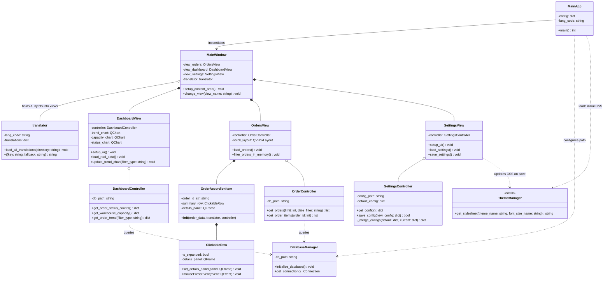
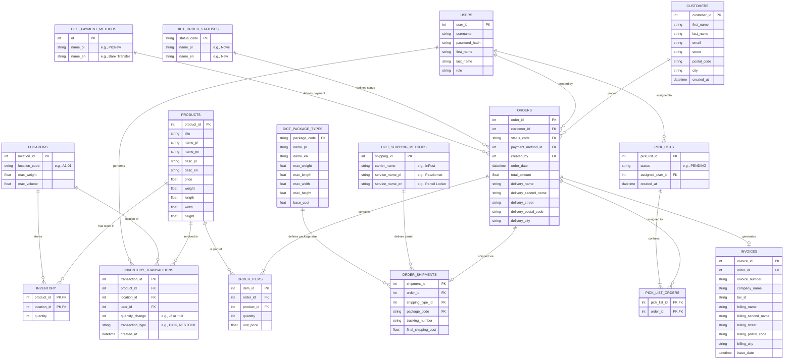

# ERP & Warehouse Management System

## 📌 Project Overview

This application is an ERP system created to monitor incoming orders and assist with warehouse operations and implementations. It provides a comprehensive set of tools to manage inventory, process shipments, and analyze business performance.

The application is built with a focus on usability and supports bilingual interface localization (English and Polish).

## 🚀 Key Features

- **Order Management:** Add, delete, modify, and manage user orders seamlessly.

- **Invoicing:** Generate and manage invoices independently of customer profiles (supporting B2B/company details and separate billing addresses).

- **Data Import:** Built-in tools to import external orders directly into the database.

- **Warehouse Control:** Track inventory levels, product locations (shelves/racks), and pick lists.

- **Analytics & Statistics:** View detailed statistics regarding sales, top products, and overall business performance.

- **Bilingual Support:** Database architecture designed to support multiple languages natively.

- **Dynamic Configuration & Theming:** Centralized settings module managing system paths, company metadata, and localization. Features a live CSS `ThemeManager` for zero-restart visual switching (Dark, Light, Modern) and scalable UI fonts safely persisted in a recursive JSON structure.

## 🛠️ Technology Stack

- **Language:** Python 3

- **GUI Framework:** PySide6 (Qt for Python) - ensuring a fast, responsive, and native desktop experience.

- **Database:** SQLite3 - lightweight, serverless, and robust internal database.

- **Configuration:** JSON - used for local application settings, paths, and user preferences.

## Running from a Checkout

Install Python 3 and PySide6, then run from the repository root:

```text
python -m pip install PySide6
python main.py
```

The database module is tracked as `models/database.py` and imported as
`models.database`. Keep this lowercase package spelling when adding imports;
startup does not require directory renaming or Python case-handling overrides.
Database initialization creates missing tables and leaves existing business
records intact.

## Browsing Existing Orders

The Orders overview consumes the controller's named SQLite fields, including
the current delivery-address columns. Empty and populated order tables can be
opened, and missing payment or shipment details retain the `-` display default.
Expanding a row shows that order's item details. Existing date and result-limit
controls reload the list without accumulating duplicate entries.

Browsing, reloading, and expanding orders do not modify order or inventory data.

## Company Settings

In **Settings > Company Data**, the company address is edited in separate
**Street**, **Postal Code**, and **City** fields. These map directly to the existing
`company_info.street`, `company_info.postal_code`, and `company_info.city` JSON
keys. Saving and reopening settings preserves each component independently.
The labels are available in English and Polish, within the existing four-page
Settings layout.

If an older configuration contains duplicated address text, correct the affected
field explicitly and save. Existing text is displayed as stored; the application
does not guess which parts to remove. No configuration migration is required.

### Regression Tests

With Python 3, PySide6, and Git installed, run from the repository root:

```text
python -B -m unittest discover -s tests -v
```

The tests use temporary configuration and database files and Qt's offscreen
platform. They do not open the application's database or modify its configuration.
Startup coverage checks Git-tracked import capitalization, launches the entry
point from a temporary tree with the exact tracked source paths and an empty
database, and verifies that database reinitialization preserves existing records.
The startup fixture uses the default database filename; consistent custom
database-path propagation remains a separate pending repair.

Order integration tests exercise the real controller with empty and populated
databases, optional joined data, date/limit reloads, item expansion and MainWindow
startup. They verify that browsing preserves persisted records.

Settings coverage includes repeated save/reopen cycles, individual component
edits, explicit correction of existing text, and address fields in both languages
and all three themes and font sizes. Change history is recorded in
[updates.md](updates.md).

## 📸 UI Preview / Screenshots

- **Orders Dashboard:** ``
- **Dark Theme Interface:** ``

📦 WMS-Project <br>
 ┣ 📂 controllers        # Business logic managers (Orders, Dashboard, Settings) <br>
 ┣ 📂 models             # SQLite database manager and models <br>
 ┣ 📂 utils              # Helpers (e.g., i18n JSON Translator, ThemeManager) <br>
 ┃ ┣ 📜 translations_*.json # Feature-based language dictionaries <br>
 ┃ ┣ 📜 translations.py  # Handles dynamic glob-based multi-language translation loading <br>
 ┃ ┗ 📜 theme_manager.py # Generates and injects global QSS stylesheets dynamically <br>
 ┣ 📂 views              # PySide6 UI views (Dashboard, Orders, Products, Settings) <br>
 ┣ 📜 main.py            # Main application router and window <br>
 ┣ 📜 seed_db.py         # Faker script for generating test data <br>
 ┗ 📜 config.json        # Local app configuration, safe fallbacks, and user preferences

## 🏛️ System Architecture (UML Class Diagram)

The application utilizes a strictly typed, component-based MVC architecture. Below is the UML representation of the core application flow, highlighting the decoupling of PySide6 Views from SQLite Business Logic. 
`MainWindow` acts as the central router, instantiating and holding the sub-views.



### Architecture Notes:
- **Separation of Concerns:** UI classes (`OrdersView`, `OrderAccordionItem`) never execute SQL. They delegate all data retrieval to the `OrderController`.
- **Dynamic Instantiation:** `OrdersView` acts as a factory, generating multiple `OrderAccordionItem` instances based on the tuple list returned by the controller.
- **Composition (*--) vs Aggregation (o--):** The diagram strictly differentiates between widgets that physically own other widgets (if you delete the View, the Accordions are destroyed) versus references to shared utilities like the `translator` or `OrderController`.

## 🗄️ Database Architecture

Below is the Entity-Relationship Diagram (ERD) mapping the core structure of the system. Dictionary tables (prefixed with `DICT_`) store names in both Polish (`name_pl`) and English (`name_en`) to natively support bilingual interface requirements.



### Database Architecture Notes:

* **Separation of Invoices:** The `INVOICES` table allows billing details (like company name and tax ID) to differ from the original `CUSTOMERS` record, supporting both B2C and B2B transactions.
* **Dictionary Tables (`DICT_`):** These enable seamless switching between languages in the PySide6 UI without hardcoding translations in the backend logic.
* **Granular Inventory:** The `INVENTORY` table acts as a junction, tracking exactly how many units of a specific product are located on a specific warehouse shelf.
